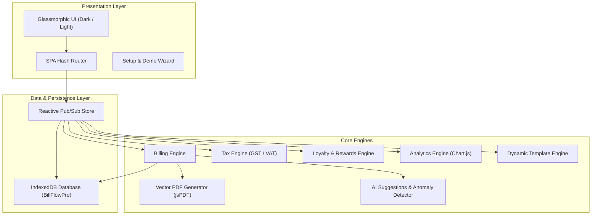

# ⚡ BillFlow Pro — Universal Industry-Agnostic Billing CRM

[](LICENSE)
[]()
[-purple.svg)]()
[]()

> **BillFlow Pro** is a next-generation, client-side billing CRM designed to adapt seamlessly across **any industry** — from pharmacies and hotels to retail supermarkets, clinics, automobile workshops, restaurants, and salons. Built with a dynamic template engine, offline-first IndexedDB persistence, AI assistant, and real-time financial intelligence.

---

## 🌟 Key Differentiators

- 🧩 **Universal Industry Template Engine**: Morph entire schemas, terminology, item fields, tax slabs, and workflows on the fly across 10 industry profiles without data loss.
- 💾 **100% Offline-First Architecture**: Runs locally inside browser **IndexedDB** with zero external backend dependencies or subscription lock-ins.
- 🧠 **AI Invoice Assistant**: Contextual item recommendations based on customer transaction history, duplicate invoice detection, and payment pattern sentiment analysis.
- 💎 **Loyalty & Rewards Engine**: 4-tier loyalty program (Bronze, Silver, Gold, Platinum) with automatic points accrual and invoice discount redemptions.
- 📊 **Real-time Financial Intelligence**: Live sales analytics, GSTR-1 compliant tax breakdown by slab (0%, 5%, 12%, 18%, 28%), Profit & Loss estimates, and accounts aging buckets.
- 🧾 **Branded PDF & Thermal Printing**: Client-side vector PDF generation using jsPDF, thermal receipt printing, and CSV/JSON export.
- 🎙️ **Voice-to-Invoice Assistant**: Hands-free voice billing command execution via Web Speech API.
- ⚡ **Rapid Counter POS Terminal**: Fast-ticket cash and simulated UPI QR checkout for high-velocity counters.

---

## 🏢 Supported Industry Profiles

| Industry | Terminology | Unique Custom Item Fields & Tax Rules |
|---|---|---|
| **💊 Pharmacy / Medical** | Sales Bill, Patient, Medicine | Batch Number, Expiry Date, Drug Schedule (H/H1/X/OTC), Rx Reference |
| **🏨 Hotel / Lodge** | Hotel Bill, Guest, Room Service | Room Number, Check-In/Check-Out Dates, Room Type (Deluxe/Suite), Guests |
| **🏪 General Store / Retail** | Sales Invoice, Customer, Product | Barcode EAN, Brand, Size/Variant, Multi-slab GST |
| **🍽️ Restaurant / Café** | Dine-In Bill, Guest, Dish/Beverage | Table Number, Steward, KOT, 5% Restaurant Tax |
| **🩺 Clinic / Hospital** | Consultation Bill, Patient, Treatment | Doctor, Department, Token, Lab Test Ref |
| **✂️ Salon / Spa** | Service Bill, Client, Treatment | Stylist, Duration, Product Add-ons |
| **🔧 Auto Workshop** | Job Card Invoice, Client, Part/Service | Vehicle Reg No, Odometer, Labor vs Parts |
| **💻 Freelancer / Agency** | Project Invoice, Client, Deliverable | Hourly Rate, Milestone, Hours Logged |
| **📱 Electronics Store** | Tax Invoice, Customer, Gadget | IMEI / Serial Number, Warranty Period, AMC |
| **⚙️ Custom Business** | Configurable, Configurable, Configurable | Fully user-defined fields, categories, and tax slabs |

---

## 🏗️ Architecture



---

## 🚀 Getting Started

### Prerequisites
Any modern web browser (Chrome, Firefox, Safari, Edge). No Node.js or database installation required!

### Running Locally

1. **Clone the repository**:
   ```bash
   git clone https://github.com/TarunSharma0007/billflow-pro.git
   cd billflow-pro
   ```

2. **Serve with any local web server**:
   ```bash
   # Python 3
   python -m http.server 8085

   # or Node.js npx
   npx serve .
   ```

3. **Open in browser**:
   Navigate to `http://localhost:8085`

4. **One-Click Demo Data**:
   On first launch, select your desired industry in the **Welcome Setup Wizard** and click **"Launch with Demo Data (Recommended)"** to test immediately with populated catalog items, customers, and invoices.

---

## 📁 Repository Structure

```
billflow-pro/
├── index.html              # Single Page Application HTML shell
├── .gitignore              # Git ignore rules
├── README.md               # Documentation & setup guide
├── css/
│   ├── design-system.css   # HSL color palettes, typography, glassmorphism tokens
│   ├── layout.css          # Responsive sidebar, header, stat grids
│   ├── components.css      # Reusable cards, buttons, modals, toasts, tables
│   └── pages.css           # Page layouts (Invoice editor, 360 CRM, Inventory)
└── js/
    ├── utils.js            # Helpers, currency formatters, CSV/JSON exports
    ├── db.js               # IndexedDB wrapper (7 transactional object stores)
    ├── templates.js        # 10 Universal industry definitions & tax rules
    ├── store.js            # Reactive pub/sub state manager
    ├── tax-engine.js       # Line item tax calculations & GST split
    ├── loyalty.js          # Points & tier management (Bronze to Platinum)
    ├── notifications.js    # Toast alert system & automated overdue checks
    ├── billing-engine.js   # Invoice generator, credit notes, stock deduction
    ├── analytics.js        # Financial calculations, P&L, aging buckets
    ├── pdf-generator.js    # PDF invoice generation with amount in words
    ├── app.js              # SPA router, omni-search, voice assistant, POS modal
    └── pages/
        ├── dashboard.js    # Live analytics dashboard & activity feed
        ├── invoices.js     # Invoice management, creation & print preview
        ├── customers.js    # Customer 360° CRM & behavioral sentiment
        ├── inventory.js    # Inventory catalog, barcodes & stock adjustments
        ├── reports.js      # Financial P&L, GSTR-1 tax summary & charts
        └── settings.js     # Business profile, industry switcher & data backup
```

---

## 📄 License

This project is licensed under the MIT License - see the LICENSE file for details.
